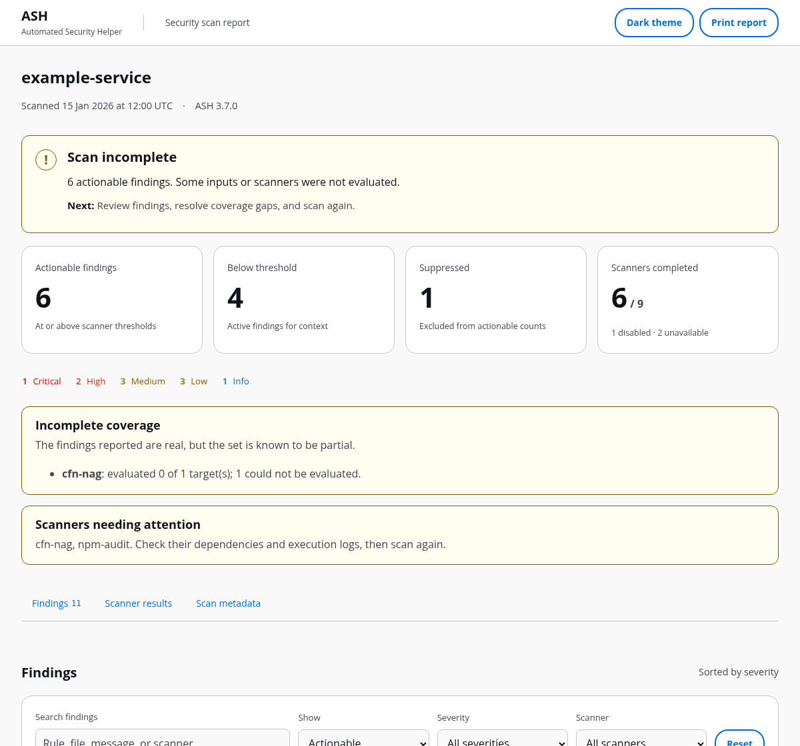
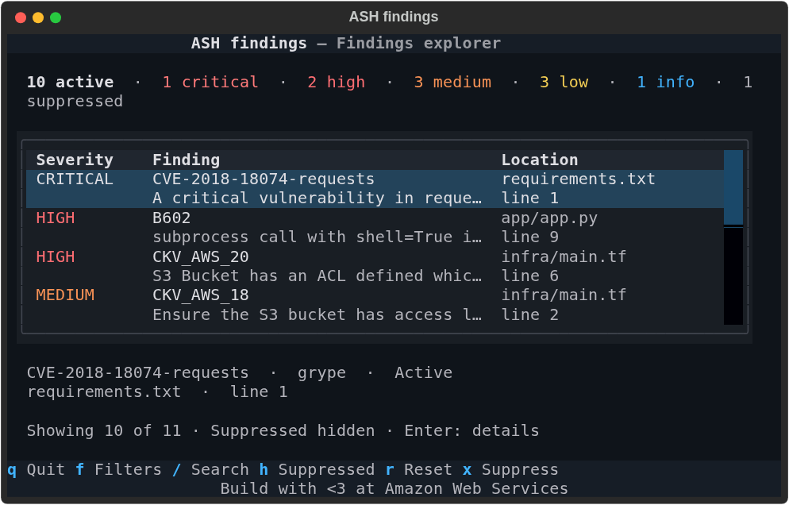

<a id="overview"></a>

# Automated Security Helper (ASH)

Open-source orchestration for code, infrastructure, secret, and dependency scanners.

[](https://github.com/awslabs/automated-security-helper/actions/workflows/ash-unified-ci.yml)
[](https://github.com/awslabs/automated-security-helper/actions/workflows/ash-install-methods.yml)

[Quick start](#quick-start) · [Reports](#reports) · [Integrations](#integrations) · [Configuration](#configuration) · [Documentation](https://awslabs.github.io/automated-security-helper/)

<a id="installation-options"></a>
<a id="basic-usage"></a>
<a id="prerequisites"></a>

<a id="your-first-scan"></a>

## Quick start

Use Python 3.10 to 3.14 and [pipx](https://pipx.pypa.io/).
For container mode, also install an OCI-compatible runtime such as Docker,
Finch, or Podman.

<!-- doctest: illustrative reason="installs ASH from GitHub over the network and starts a container scan" -->
```bash
pipx install git+https://github.com/awslabs/automated-security-helper.git@v3.7.1

# Run from the project you want to scan
ash --mode container
```

The first container run builds the image and prepares scanner dependencies.
Open `.ash/ash_output/reports/ash.html` or run `ash inspect findings`.

### Execution modes

| Mode | Command | Requirements |
| --- | --- | --- |
| Container | `ash --mode container` | OCI-compatible runtime |
| Local | `ash --mode local` | Local scanner dependencies |
| Pre-commit | `ash --mode precommit` | Python-based scanners with simplified output |

Local and pre-commit workflows use [uv](https://docs.astral.sh/uv/getting-started/installation/)
for managed tool installation. The [installation guide](docs/content/how-to/install.md)
covers platform prerequisites and dependency setup.

<details>
<summary>Other installation methods</summary>

Run with uv:

<!-- doctest: illustrative reason="runs ASH from GitHub over the network" -->
```bash
uvx --from git+https://github.com/awslabs/automated-security-helper.git@v3.7.1 ash --help
uvx --from git+https://github.com/awslabs/automated-security-helper.git@v3.7.1 ash --mode container
```

Install in a Python environment:

<!-- doctest: illustrative reason="installs ASH from GitHub over the network" -->
```bash
pip install git+https://github.com/awslabs/automated-security-helper.git@v3.7.1
```

Install with Homebrew:

<!-- doctest: illustrative reason="installs ASH with Homebrew over the network" -->
```bash
brew tap awslabs/automated-security-helper https://github.com/awslabs/automated-security-helper.git
brew trust awslabs/automated-security-helper
brew install ash
```

Homebrew refuses to load a formula by its short name, as in `brew install ash`, from a tap you have not trusted, so the second line trusts this one; on a Homebrew without `brew trust`, skip that line. Naming the formula in full needs no `brew trust`: `brew install awslabs/automated-security-helper/ash` trusts that one formula as it installs it. The formula builds the tagged release on Homebrew's Python 3.12, with ASH's `cdk` extra, and installs the dependency versions locked in that release's `uv.lock`. It downloads them from PyPI during the install, so the install needs network access, and building with `HOMEBREW_FORMULA_BUILD_NETWORK=deny` is not supported. The formula also installs Node.js, which cdk-nag and npm-audit run on. grype, syft, opengrep and cfn-nag are separate programs that the formula does not install: `ash dependencies install` adds grype, syft and opengrep, and cfn-nag needs Ruby (`gem install cfn-nag`). Until they are installed, a default scan reports them MISSING and exits 1. In container mode, a Homebrew install builds its image from the commit the formula built, or, when Homebrew built it from a source tarball with no git metadata, from the release tag of its version, with a warning that this is a guess.

Install from source:

<!-- doctest: illustrative reason="clones this repository and installs it over the network" -->
```bash
git clone --branch v3.7.1 https://github.com/awslabs/automated-security-helper.git
cd automated-security-helper
pip install .
```

Pin `@v3.7.1` for a reproducible install. The floating `@v3` tag follows
stable v3 releases. See the [installation guide](docs/content/how-to/install.md)
for Windows and offline environments.

</details>

<a id="review-the-results"></a>

## Reports

- Check the outcome and scanner coverage.
- Review findings by severity.
- Inspect rule IDs, locations, and evidence.

<picture>
  <source media="(prefers-color-scheme: dark)" srcset="docs/assets/readme/report-dark.png">
  <source media="(prefers-color-scheme: light)" srcset="docs/assets/readme/report-light.png">
  
</picture>

Example scan results.

Offline HTML reports include search, filters, finding details, and printing.

<!-- doctest: illustrative reason="opens an interactive explorer on the results of an earlier scan" -->
```bash
ash inspect findings    # Open the terminal findings explorer
ash report              # Read the text summary of the latest scan
```

<details>
<summary>Terminal findings explorer</summary>



Use the footer shortcuts to search, filter, inspect, and suppress.

</details>

<a id="output-files"></a>

### Output files

Default output lives in `.ash/ash_output/`. Enabled reporters write into `reports/`.

| Artifact | Use it for |
| --- | --- |
| `reports/ash.html` | Offline review, filtering, and printing |
| `reports/ash.summary.md` | Pull request comments and Actions summaries |
| `reports/ash.summary.txt` | A readable summary in a file or terminal |
| `reports/ash.sarif` | IDE annotations and SARIF consumers |
| `reports/ash.flat.json` | Scripts and dashboards |
| `reports/ash.csv` | Spreadsheet analysis |
| `ash_aggregated_results.json` | The complete scan record and validation data |

ASH also supports JUnit XML, CycloneDX, SPDX, OCSF, GitLab, YAML, and AWS
reporting destinations. See the [complete format guide](docs/content/reference/output-files.md).

Exit status: `0` means no actionable findings, or findings are allowed by
policy; `1` means execution needs attention; `2` means actionable findings with
failure-on-findings enabled; `3` means a configuration ASH cannot use or an
input it refuses; `4` means a workspace definition or policy error; `5` means a
usage error. A scan with incomplete coverage needs follow-up.
Filters change the view; configured thresholds determine the scan gate.

<a id="bring-ash-into-your-workflow"></a>

## Integrations

| Your workflow | Next step |
| --- | --- |
| CI and pull requests | [Run ASH in CI](docs/content/getting-started/ci.md) |
| Before a commit | [Set up pre-commit](docs/content/how-to/pre-commit.md) |
| AI coding assistant | [Install an editor or agent integration](ash-agent-plugins/README.md) |
| MCP client | [Connect a client](docs/content/getting-started/agents.md) |
| Multiple projects | [Scan a workspace over MCP](docs/content/how-to/scale-large-repos.md) |
| AWS reporting | [Choose an AWS destination](docs/content/plugins/aws.md) |
| A custom scanner or report | [Build an ASH plugin](docs/content/plugins/index.md) |

See [integration options](docs/content/integrations.md).

<a id="ai-integration-with-mcp"></a>
<a id="installing-ash-into-an-ai-coding-agent"></a>
<a id="client-configuration"></a>

### Connect an AI assistant

After installing ASH, add this server to your MCP client's configuration:

<!-- doctest: config kind=mcp-client -->
```json
{
  "mcpServers": {
    "ash": {
      "command": "ash",
      "args": ["mcp"]
    }
  }
}
```

Stop polling on `completed`, `incomplete`, `failed`, or `cancelled`.
Check scanner coverage before reviewing findings.

For agent instructions, install the `ash-mcp` skill:

<!-- doctest: illustrative reason="installs an agent skill over the network" -->
```bash
npx skills add awslabs/automated-security-helper
```

The skill supplies workflow guidance. Configure the MCP server as above, or use
a [platform integration](ash-agent-plugins/README.md) that includes server wiring.
The [MCP server guide](docs/content/how-to/mcp-server.md) covers client-specific
setup. The [HTTP transport guide](docs/content/how-to/mcp-server.md) covers
remote source delivery, session handling, and deployment configuration.

<details>
<summary>MCP tools</summary>

| Tool | Action |
| --- | --- |
| `get_scan_progress` | Read scan status and partial results |
| `get_scan_results` | Read results after a completed or incomplete scan |
| `list_active_scans` | List this session's active and recent scans |
| `cancel_scan` | Cancel a running scan this session started |
| `check_installation` | Check ASH and scanner dependencies |
| `run_ash_scan` | Run a synchronous scan |
| `get_scan_summary` | Read counts, severity, and scan status |
| `get_scan_result_paths` | Locate generated report files |
| `explain_finding` | Look up one finding by ID |
| `get_config` | Read the resolved configuration |
| `diff_scan_results` | Compare two aggregated result files |
| `suggest_suppression` | Draft a suppression for review |
| `resolve_ash_workspace` | Preview a workspace scan plan |
| `run_ash_workspace_scan` | Scan workspace projects with their configurations |
| `list_scanners` | List the built-in and community scanners ASH ships, with metadata |
| `validate_config` | Check a configuration against the schema |
| `list_profiles` | List registered configuration profiles |
| `select_profile` | Apply a profile to the session |
| `set_source_git` | Clone a repository from a host the operator allowed as the scan target |
| `set_source_zip_chunk` | Upload a source archive chunk, up to 1 MiB |
| `set_source_zip_finalize` | Verify and extract the uploaded archive |
| `clear_source` | Delete the delivered source tree |

See the [tool reference](docs/content/reference/mcp-tools.md) for complete
inputs and outputs. Source-delivery tools use the session the server issued on a
network connection, never a client-chosen header; a stateless server issues no
session unless started with `--trust-upstream-session-id`. A local stdio client
can name local paths directly.

</details>

### Add a pre-commit check

Add to `.pre-commit-config.yaml`:

<!-- doctest: config kind=pre-commit -->
```yaml
repos:
  - repo: https://github.com/awslabs/automated-security-helper
    rev: v3.7.1
    hooks:
      - id: ash
```

Run `pre-commit run ash --all-files` to check the project.

The `ash` hook runs precommit mode (bandit, detect-secrets, checkov, cdk-nag and npm-audit) and installs the `cdk` extra into its environment. It needs pre-commit running on Python 3.10 to 3.14, and Node.js and npm on `PATH` for cdk-nag and npm-audit. `ash-simple-scan` is the same hook under its earlier id, and `ash-full-scan` scans in the ASH container image instead. See [Run ASH with pre-commit](docs/content/how-to/pre-commit.md) for running without Node.js and for the container hook.

<a id="configuration"></a>

<a id="make-it-fit-your-project"></a>

## Configuration

Create `.ashrc.yaml` at the project root to name the project, set the severity
gate, and choose scanner and reporter options (existing configs under the older
`.ash/.ash.yaml` name keep loading). The schema provides editor validation.

```yaml
# yaml-language-server: $schema=https://raw.githubusercontent.com/awslabs/automated-security-helper/refs/heads/main/automated_security_helper/schemas/AshConfig.json
project_name: my-project
global_settings:
  severity_threshold: MEDIUM
scanners:
  bandit:
    enabled: true
    options:
      confidence_level: high
reporters:
  markdown:
    enabled: true
    options:
      include_detailed_findings: true
```

Use the [configuration guide](docs/content/how-to/configure.md) for
settings and overrides, the [suppression guide](docs/content/how-to/suppress-findings.md)
for an accepted finding with a recorded reason, and [plugin development](docs/content/plugins/index.md)
for new capabilities.

<a id="built-in-scanners"></a>

<details>
<summary>Scanner coverage and local setup</summary>

| Scanner | Coverage | Local setup |
| --- | --- | --- |
| [Bandit](https://github.com/PyCQA/bandit) | Python code | Managed through uv tool isolation |
| [Semgrep](https://github.com/semgrep/semgrep) | Application code across multiple languages | Managed through uv tool isolation |
| [Opengrep](https://github.com/opengrep/opengrep) | Application code with Semgrep-compatible rules | Managed through uv tool isolation |
| [detect-secrets](https://github.com/Yelp/detect-secrets) | Secrets in text files | Included with ASH |
| [Checkov](https://github.com/bridgecrewio/checkov) | Infrastructure and configuration | Managed through uv tool isolation |
| [cfn-nag](https://github.com/stelligent/cfn_nag) | CloudFormation | Ruby and cfn-nag |
| [cdk-nag](https://github.com/cdklabs/cdk-nag) | CloudFormation | ASH's `cdk` extra, and Node.js |
| [npm-audit](https://docs.npmjs.com/cli/commands/npm-audit) | Node.js dependencies | Node.js and npm |
| [Grype](https://github.com/anchore/grype) | Dependency vulnerabilities | Grype |
| [Syft](https://github.com/anchore/syft) | Software bill of materials | Syft |
| [gitleaks](https://github.com/gitleaks/gitleaks) | Secrets in text files | `ash dependencies install` (pinned release binary) |
| [cfn-lint](https://github.com/aws-cloudformation/cfn-lint) | CloudFormation | Managed through uv tool isolation |
| [cfn-guard](https://github.com/aws-cloudformation/cloudformation-guard) | CloudFormation (AWS Guard Rules Registry rules) | `ash dependencies install` (pinned binary and rules) |
| [Trivy](https://github.com/aquasecurity/trivy) (`trivy fs`) | Dependency vulnerabilities | `ash dependencies install` (pinned release binary) |
| [actionlint](https://github.com/rhysd/actionlint) | GitHub Actions workflows | `ash dependencies install` (pinned release binary) |
| [zizmor](https://github.com/zizmorcore/zizmor) | GitHub Actions workflows and composite actions | Managed through uv tool isolation |

Enabled scanners depend on your execution mode and configuration. Check the
[scanner catalog](docs/content/reference/scanners.md) for capabilities
and the [language guide](docs/content/reference/coverage.md) for coverage.

</details>

<a id="faq"></a>
<a id="documentation"></a>
<a id="feedback-and-contributing"></a>

## Documentation

| Task | Reference |
| --- | --- |
| Understand a command | [CLI reference](docs/content/reference/cli.md) |
| Recover from a setup or scan issue | [Troubleshooting](docs/content/how-to/troubleshoot.md) |
| Understand scanner coverage | [Languages and frameworks](docs/content/reference/coverage.md) |
| Read common answers | [FAQ](docs/content/faq.md) |
| Contribute a change | [Contributing](CONTRIBUTING.md) and [development setup](DEVELOPMENT.md) |
| Review the interfaces | [Design system](docs/content/developer-guide/interface-design.md) and [all-surface review](docs/content/developer-guide/high-end-design-review.md) |

<a id="security"></a>

Report bugs and feature requests through [GitHub issues](https://github.com/awslabs/automated-security-helper/issues).
For security concerns, follow [Security issue notifications](CONTRIBUTING.md#security-issue-notifications).

<a id="license"></a>

Licensed under [Apache 2.0](LICENSE). Bundled fonts and icons retain their
respective licenses alongside their assets.

Build with <3 at Amazon Web Services
