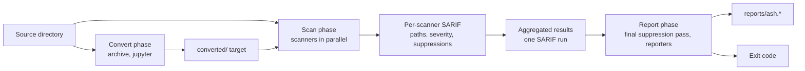

# How ASH works

ASH runs a set of third-party security scanners over one directory, collects what they report into one results model, writes that model out in several report formats, and returns one exit code. This page explains each of those steps and the rules that connect them.

## Phases

A scan runs up to three phases, always in this order: convert, scan, and report. `--phases` runs a subset of them, and `ash report` renders reports again from an existing results file without scanning.

In the convert phase, converters turn files that scanners cannot read into files they can. The archive converter extracts the scannable members of zip and tar archives (`.zip`, `.tar`, and `.gz`), and the jupyter converter turns notebooks into scripts with nbconvert. Their output goes to `converted/` in the output directory and becomes a second scan target, `converted`, next to the `source` target. A converter that crashes, or that cannot convert one of its inputs, makes the scan incomplete.

In the scan phase, each selected scanner runs its tool against each target and produces SARIF. ASH rewrites the paths in that SARIF relative to the source directory, maps each result to a severity, applies suppressions and ignore paths, and merges the result into the aggregated SARIF.

In the report phase, ASH applies suppressions once more to the merged SARIF, recomputes the counts, and runs every enabled reporter. Each reporter writes its file under `reports/`, named `ash.<extension>`. A reporter that fails logs an error and writes nothing; it does not change the exit code.

Where the scan runs is a separate choice, the run mode. `local` (the default) runs the scanners installed on the host. `container` builds an image and runs the same scan inside it. `nix` runs it inside `nix develop`, which supplies pinned scanner binaries. `precommit` runs a fixed set of fast scanners (bandit, detect-secrets, checkov, cdk-nag, and npm-audit). See [Run ASH in a container](../how-to/run-in-a-container.md) and [Run ASH with pre-commit](../how-to/pre-commit.md).

## How scanners are selected

ASH ships 16 built-in scanners, all enabled by default except semgrep and opengrep on Windows. For each scanner it knows about, ASH asks these questions in order and records the first answer that stops the scanner:

1. Is it enabled? `scanners.<name>.enabled: false` in the config turns a scanner off. `--scanners` cannot turn it back on; `ash scan --config-overrides scanners.<name>.enabled=true` can.
2. Was it selected? `--scanners` is an allowlist and `--exclude-scanners` removes names from it. A scanner that is not selected is recorded SKIPPED.
3. Does it support this platform? A scanner that declares the operating system unsupported (semgrep on Windows) is recorded SKIPPED.
4. Are its dependencies there? A scanner whose tool cannot be found, or is found only inside the scanned directory, is recorded MISSING.

Scanners outside the built-in set, such as the [community scanners](../docs/plugins/community/index.md), are considered only when their plugin module is loaded; for the MCP server, see [What a plugin can do](../plugins/index.md#what-a-plugin-can-do). The [scanner reference](../reference/scanners.md) lists every scanner, its tool, and its defaults; [Choose scanners](../how-to/choose-scanners.md) covers turning them on and off.

## How scanners run

With the default `--strategy parallel`, ASH runs scanners in a thread pool of `min(32, CPUs + 4)` workers. Each worker runs one scanner against the source target and then against the converted target when there is one. `--strategy sequential` runs them one at a time.

A scanner receives a directory, not a file list. Most scanners walk that directory themselves. ASH passes the configured ignore paths to every scanner. Some scanners use them to skip files, and ASH applies them again to the results. Each scanner's tool runs as a subprocess. When the [sandbox](sandbox.md) is on, the processes a scanner starts through ASH run inside it; ASH's own process does not.

## The results model

The engine writes everything a scan produced to `ash_aggregated_results.json` at the root of the output directory. It holds:

- the resolved configuration the scan used;
- one row per scanner and target, with a status (PASSED, FAILED, ERROR, MISSING, or SKIPPED) and counts by severity, plus the reason when ASH refused a scanner's tool because it was found only inside the scanned directory;
- one row per converter, with the inputs it could not convert;
- the aggregated SARIF;
- an SBOM in CycloneDX form when an SBOM scanner ran.

Each scanner's own output is also kept under `scanners/<name>/<target>/`. Every reporter renders this same model. The layout of the output directory is in [Output files](../reference/output-files.md).

The aggregated SARIF has a single run. Each scanner's results are appended to it, and each scanner's tool description and rules are added to `tool.extensions`. Every result carries `scanner_name` in its properties, so you can tell which scanner reported it. A result's severity comes from the scanner's own severity when it reports one, and otherwise from the SARIF level: `error` counts as critical, `warning` as medium, and `note` as low.

## Findings are merged, not deduplicated

ASH does not deduplicate findings, within a scan or across shards. When two scanners report the same problem, the results contain two findings, each with its own scanner name and rule ID. The default scanner set overlaps in several places:

- semgrep and opengrep both run the `p/ci` ruleset;
- grype and trivy both match dependency manifests against vulnerability advisories;
- detect-secrets and gitleaks both look for secrets;
- several scanners evaluate CloudFormation templates.

This has three consequences. Finding counts are counts of scanner results, not of distinct problems. A suppression that names a `rule_id` matches the rule IDs of whichever scanner uses that ID, so the same problem reported by another scanner under another ID stays unsuppressed; a suppression without `rule_id` covers every rule in its path. And the gate counts every unsuppressed duplicate. If two scanners overlap more than you want, turn one of them off; see [Choose scanners](../how-to/choose-scanners.md). [Suppressions, ignore paths, and scanner exclusions](suppressions.md) explains how suppressions match.

Sharding splits a scan by scanner, not by file, so `ash merge` of the shards does not count any finding twice. See [Scale to large repositories](../how-to/scale-large-repos.md).

## Where the exit code comes from

ASH decides the exit code after the report phase, from the scanner rows and the unsuppressed findings in the aggregated SARIF. It checks the conditions in a fixed order and stops at the first that holds, so an incomplete scan (exit 1) wins over findings (exit 2), and a stale content database fails the scan even with `fail_on_findings` off. An invalid configuration stops the scan before it starts (exit 3), and exit 4 is a workspace error. [Exit codes](../reference/exit-codes.md#scan-precedence) lists the order, and [Set the gate](../how-to/set-the-gate.md) shows how to choose what fails a build.

## Plugins

Scanners, reporters, and converters are all plugins, and so are event subscribers, which run code on scan events such as a phase starting or a scanner finishing. The built-in plugins live in one package that every scan loads. Other plugin packages, including the community scanners and the AWS reporters that ship with ASH, load in `ash scan` only when a plugin module list names them: `ash_plugin_modules` in the config, `--config-overrides`, `--ash-plugin-modules`, `ASH_PLUGIN_MODULES`, or the Python API's `ash_plugin_modules` argument. For the MCP server, see [What a plugin can do](../plugins/index.md#what-a-plugin-can-do). A plugin module is imported into ASH's own process and runs with ASH's access, outside the scanner sandbox; only the subprocesses a scanner starts through ASH are sandboxed. Which config files may name which modules is part of the [trust model](trust-model.md). [Plugins](../plugins/index.md) explains the plugin model and how to write one.
