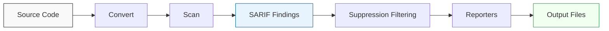

# Core Concepts

This page explains the domain model behind ASH — the key abstractions and how they fit together.

## Finding

A finding is a single security issue detected by a scanner. Each finding has a rule ID, severity level, source location (file and line), and a message describing the problem. Internally, ASH represents all findings in SARIF format regardless of which scanner produced them.

## Scanner

A scanner is a plugin that analyzes source code, configuration files, or container images for a specific class of vulnerabilities. Each scanner wraps an external tool (like Bandit, Checkov, or Grype), invokes it against the target, and translates its output into SARIF findings. ASH ships with built-in scanners and supports community-contributed ones.

ASH runs a scanner's tool from outside the directory it is scanning. A copy inside it, such as one in the project's `.venv/bin` or `node_modules/.bin` that `uv run ash` or `npm run` put first on `PATH`, is skipped; with no other copy the scanner is MISSING, and its `missing_reason` names the in-tree path. `--allow-in-tree-tools` or `ASH_ALLOW_IN_TREE_TOOLS=1` allows in-tree tools for one run, the scanner sandbox's own programs included. A configuration file cannot turn this on, and `ash mcp` never does. See [Tools inside the scanned directory](advanced-usage.md#tools-inside-the-scanned-directory).

## Converter

A converter transforms input files into a format that scanners can process. For example, a converter might extract files from a ZIP archive, convert Jupyter notebooks to Python scripts, or render Helm charts into Kubernetes manifests. Converters run before scanners in the pipeline.

The Jupyter converter runs nbconvert outside the scanned tree on a copy named `notebook.ipynb`, so a notebook whose name contains glob or format characters, such as `[x].ipynb`, converts, and the result is named after the original. A file a converter could not convert, such as a notebook nbconvert failed on or a `.zip`, `.tar` or `.gz` file that is not an archive Python can read, is recorded in `converter_results.<name>.failed_inputs` and makes the scan incomplete, which exits 1 by default as a scanner that did not run does. `ash merge` combines every shard's failed inputs, and workspace mode reports them per project. A `.gz` that is one compressed file rather than a tarball, such as `data.json.gz`, is decompressed and scanned, and is a failed input only when it cannot be decompressed. See [Inputs a converter could not convert](plugins/builtin/converters.md#inputs-a-converter-could-not-convert).

## Reporter

A reporter takes the aggregated SARIF findings and produces output in a specific format. Built-in reporters generate HTML dashboards, CSV spreadsheets, SARIF files, CycloneDX SBOMs, and OCSF events. AWS reporters can push findings to Security Hub, CloudWatch Logs, or S3.

## Suppression

A suppression is a rule that hides a known-accepted finding from results. Suppressions can be config-based (defined in `.ash-config.yml` by rule ID, file path, or pattern) or inline (a code comment like `# ash-ignore:rule-id` placed next to the flagged line). Suppressed findings are still recorded but marked as suppressed in the output.

## Configuration trust

ASH's configuration can come from the operator who runs it, from the repository being scanned, or, under the MCP server, from a client. Everything the operator sets applies: the defaults, a config file outside the scanned tree, `--config-overrides`, `--ash-plugin-modules`, and the profiles the MCP server registers. A config file inside the scanned tree cannot choose what ASH installs or imports, a scanner's own config files, the sandbox's grants, where reporters send findings or the credentials they use, or a plugin package that sends data off the host; those come from the operator. A config file an MCP client delivered is limited the same way, and may not change a field the session's runtime-override policy (`denied_paths`) denies either. So is a profile the client patched with `select_profile`, and so are the MCP workspace tools' `config_overrides`: the allowlist decides which keys a client may change, not whose the values are. Its suppressions and ignore paths apply, and its scanner exclusions are applied as suppressions, but every finding any of them hides is kept in the results, suppressed and marked client-supplied. See [Settings a repository's config cannot choose](configuration-guide.md#settings-a-repositorys-config-cannot-choose) and [Config files in delivered source](mcp/streamable-http.md#config-files-in-delivered-source).

## Phases

ASH processes code in four sequential phases:

1. **Convert** — transform input files into scannable formats
2. **Scan** — run all enabled scanners against the (converted) source
3. **Report** — generate output files from the collected findings
4. **Inspect** — launch an interactive UI for reviewing results (optional)

## Modes

ASH supports four execution modes:

- **Local** — runs scanners directly on the host using UV-managed tool installations
- **Container** — runs inside a Docker container with all tools pre-installed
- **Pre-commit** — a local scan limited to bandit, detect-secrets, checkov, cdk-nag and npm-audit, with simplified output; it scans the whole source directory, not only staged files
- **Nix** — runs the scan inside `nix develop`, with every scanner at a pinned version, always offline

## Output directory

A scan writes to an output directory: `.ash/ash_output` in the directory ASH runs from unless `--output-dir` names another, which is inside the scanned directory when you scan the one you are in. Before a scan ASH clears `analysis`, `reports`, `scanners` and `converted` there, then writes its logs, results and reports, and a sandboxed scan mounts the directory. So ASH refuses, whatever the sandbox mode and before writing anything, an output directory when any of these is a symlink or a directory junction:

- the output directory itself;
- a directory inside the scanned tree on the way to it, however either path is spelled (an in-tree output directory whose real path is outside the tree is refused too);
- `analysis`, `reports`, `scanners` or `converted` under it;
- a file ASH writes there by a fixed name: `ash.log`, `ash.log.jsonl`, `ash_aggregated_results.json`, `ash-ignore-report.txt`, `ash-scan-set-files-list.txt`;
- in workspace mode, `projects/`, each `projects/<key>` and `.workspace-spool`.

The error names the link; pass `--output-dir` with a directory that is not a link. This applies to local, container, nix, workspace and MCP scans, and `ash report` and `ash merge` refuse a linked output or `reports` directory the same way. A link above an output directory outside the scanned tree, such as `/tmp` on macOS, is your own spelling and is accepted. See [Troubleshooting](troubleshooting.md#the-scan-stops-because-something-in-the-output-directory-is-a-symlink).

## SARIF

SARIF (Static Analysis Results Interchange Format) is the internal data model. Every scanner produces SARIF output, every suppression rule matches against SARIF properties, and every reporter consumes SARIF as input. This common format lets ASH treat all scanners uniformly regardless of their native output format.

## Data Flow

The following diagram shows how findings flow through the system:

Source code enters the pipeline, converters prepare it, scanners produce SARIF findings, suppression rules filter out accepted issues, and reporters write the final output in the requested formats.
