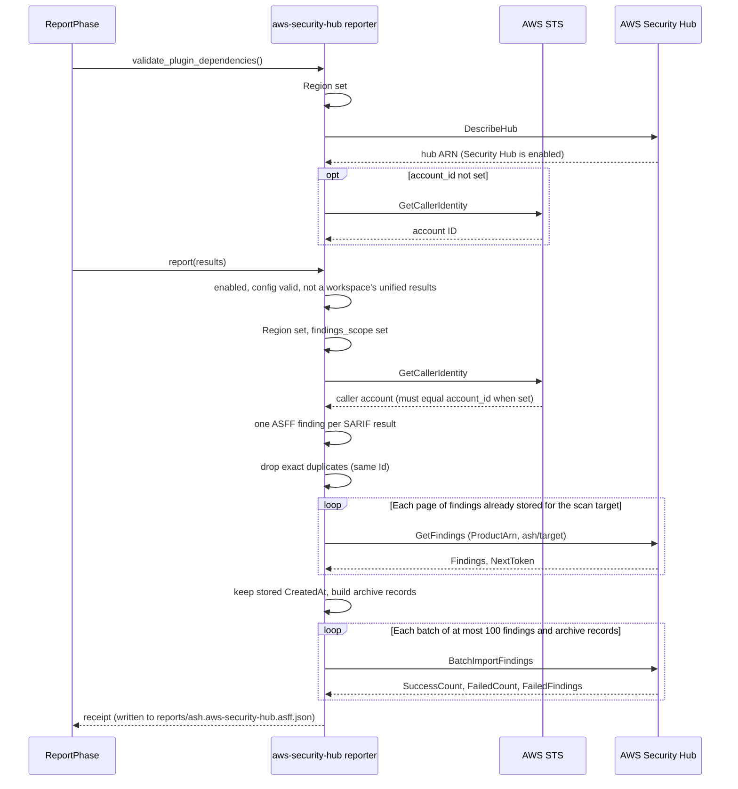
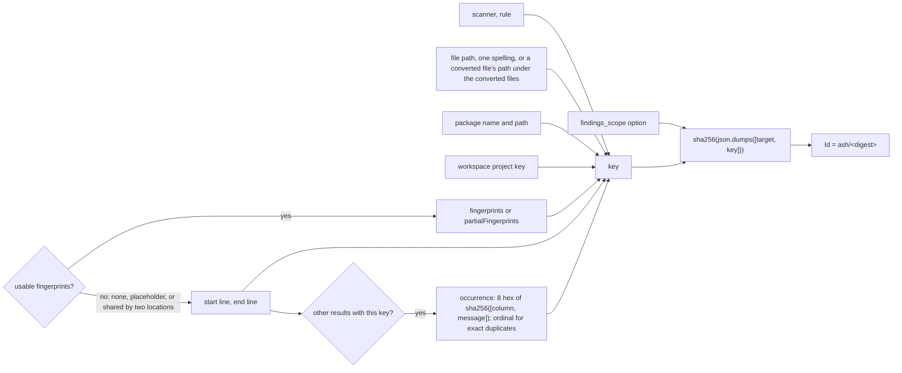
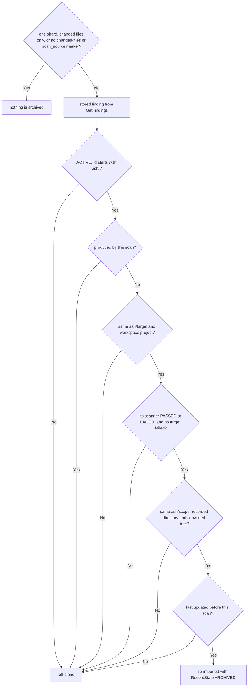
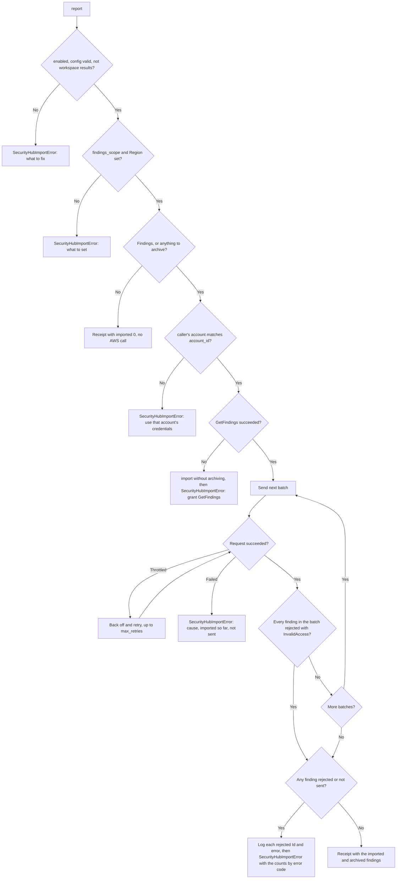

# Security Hub Reporter Diagrams

These diagrams show what the [Security Hub Reporter](security-hub-reporter.md) does during a scan in which it is enabled.

## Sequence

`GetFindings` runs only when `archive_resolved_findings` is true (it is false by default).

## Finding identity

The scan time, the report id, the message, the severity, the column and the package version are not in the key, so a re-scan updates the same finding. The column and message only tell apart findings that share a key.

## Which stored findings are archived

Only with `archive_resolved_findings: true`.

## Failure handling

A `SecurityHubImportError` makes the reporter fail: ReportPhase logs it and writes no receipt, and `ash report` exits 1.
