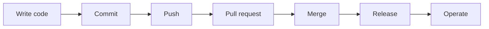

# ASH across the SDLC and AI-DLC

A security scan is cheap or expensive depending on when it runs. The same
finding costs seconds while the code is in the editor, a push and a context
switch once it is on a pull request, and an incident once it is in production.
ASH is one scanner harness you can place at every one of those moments, so each
moment runs the check it can afford and the complete scan still happens where
it belongs.

## The lifecycle, moment by moment

| Moment | What runs | Guide |
|---|---|---|
| Write code | A terminal scan scoped to fast scanners, `ash inspect findings` to work through results, or a scan the editor's agent runs over MCP | [Scan on your machine](../getting-started/local.md), [Connect an AI agent](../getting-started/agents.md) |
| Commit | The `ash` pre-commit hook: precommit mode's five fast scanners, seconds per commit after the first run | [Run ASH with pre-commit](../how-to/pre-commit.md) |
| Push | The same hook on `stages: [pre-push]`, or `ash-full-scan` for the container image's full scanner set | [When the hook runs](../how-to/pre-commit.md#stages), [The ash-full-scan hook](../how-to/pre-commit.md#full-scan) |
| Pull request | The complete scan on a clean runner, gating on the exit code; the summary as a comment, findings as code scanning annotations, `--changed-files-only` so the gate counts the change's own findings | [Add ASH to CI](../getting-started/ci.md), [Gate on the files a change touches](../how-to/scale-large-repos.md#changed-files) |
| Merge | A scan of the default branch after each merge, which keeps the baseline that code scanning compares later pull requests against | [Add ASH to CI](../getting-started/ci.md) |
| Release | A scan from a pinned ASH release or an image you built, with the SBOM (`ash.cdx.json`) among the reports | [Roll out across repositories](../getting-started/platform-teams.md), [CycloneDX and SPDX](../how-to/export-reports.md#sbom) |
| Operate | Rescans on a schedule: grype and trivy read vulnerability databases that age, so an unchanged tree can gain findings, and ASH fails a scan whose database is stale rather than reporting from it | [Plan content database refresh](../getting-started/platform-teams.md), [Content databases](../concepts/content-databases.md) |

Three properties hold across the row boundaries. The scan is the same `ash`
everywhere, so a finding reproduces locally with one command. The verdict is
the [exit code](../reference/exit-codes.md) everywhere, so every gate reads the
same signal. And an accepted risk is a
[suppression](../how-to/suppress-findings.md) with a reason and an expiration,
recorded once in configuration and honored at every moment.

## The same moments, AI-assisted

When an agent writes the code, the lifecycle keeps its shape and loses its
pauses: the agent commits many times an hour, does not get tired of a slow
hook (but will route around one if its instructions allow), and can read scan
results itself. The checkpoints map over directly:

| Human loop | Agent loop | What ASH does there |
|---|---|---|
| Write code in an editor | The agent generates code for a task | The agent scans over [MCP](../getting-started/agents.md) and fixes actionable findings before presenting the work |
| Commit and push hooks | The agent's task or Unit ends | A precommit-mode scan at the task boundary rather than at each of dozens of commits; the hooks still back it up |
| Review the pull request | A human approval gate | The scan summary, the diff's suppressions with reasons and expirations, and `diff_scan_results` between before and after |
| Triage a backlog | MCP-driven triage | `explain_finding` for context, `suggest_suppression` for a drafted, expiring exception a human approves ([MCP tools](../reference/mcp-tools.md)) |

Two practices from the persona pages matter more here. Give the agent ASH's
own instructions (`ash get-genai-guide`, or an
[agent plugin](../how-to/agent-plugins.md) that packages the server and the
guidance), so scanning is part of its definition of done rather than a step it
can skip. And treat generated or fetched code as
[untrusted input to the scanners](../concepts/scanning-untrusted-code.md): the
[scanner sandbox](../concepts/sandbox.md) exists for exactly this.

## AI-DLC, and running ASH at its checkpoints

[AI-DLC](https://github.com/awslabs/aidlc-workflows) (AI-Driven Development
Life Cycle, the `awslabs/aidlc-workflows` project on GitHub) is an AWS Labs
methodology that, in its own words, "turns AI coding assistants into
structured, verifiable software-delivery workflows". One engine runs the same
workflows in Claude Code, Kiro, Codex CLI, Cursor, opencode, and GitHub
Copilot: five phases from initialization through operation, stages with human
approval gates, an audit trail, and workflow profiles for common kinds of
work. Where the table above names moments in a repository's life, AI-DLC names
stages in a delivery workflow, and two of its construction stages are exactly
where ASH belongs:

- Code Generation runs once per Unit of work, led by a developer agent. A fast
  ASH scan there gives the agent findings while it still holds the context to
  fix them, before the Unit's completion handoff.
- Build and Test runs once per intent, after all Units. A full ASH scan there
  is the security half of the build gate, and its scanner table belongs in the
  stage summary the human reads at the approval gate.

AI-DLC has a plugin mechanism for exactly this kind of addition: a plugin
composes new steps into core stages without editing them, and ships house
rules the engine keeps in front of the agent. ASH's repository carries a
worked example in that format,
[`examples/aidlc-workflows/ash-scan`](https://github.com/awslabs/automated-security-helper/tree/main/examples/aidlc-workflows/ash-scan),
which adds the two scans above and a rules file with ASH habits (read the exit
code; suppress with a reason and an expiry instead of loosening the gate). Its
README covers validating and building it with AI-DLC's own plugin tools.

The division of labor is deliberate. AI-DLC decides when the agent must stop
and show its work; ASH decides whether the code passes and keeps the record.
Suppressions written during a workflow surface in stage summaries at approval
gates, so the human approves the exceptions, and the pipeline scans from the
lifecycle table still run unchanged: an AI-DLC workflow ends in a pull
request, and the pull request's gate neither knows nor cares who wrote the
code.
